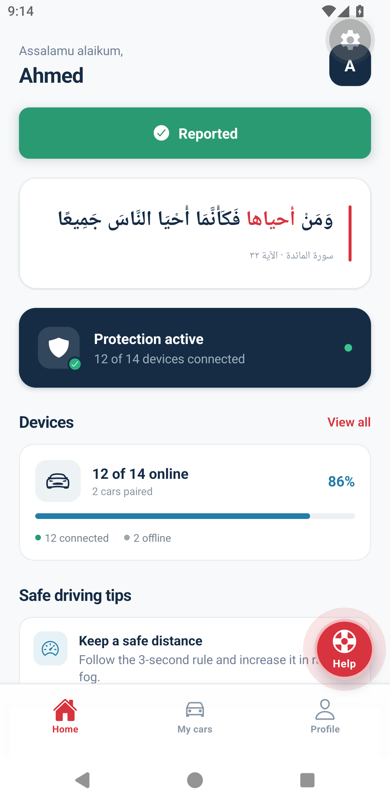

# CrashCare Mobile App

**CrashCare** is a car-crash emergency-response app. Every car carries care devices (GPS, accelerometer, speed sensor, etc.); when a crash happens, the app takes over immediately: it asks if you're okay, and if you can't respond it alerts an ambulance and everyone around you who can give first aid.

Built with **Expo / React Native + TypeScript**, React Navigation, and a WebSocket link for live incident updates.

---

## Screens

### 🏠 Home: the protection dashboard

The main tab. It greets you by name, shows the current state of your cars' care devices, and shares safe-driving tips. A floating **Help** button is always available in the corner of every screen.


- **Ayah card**: Surat Al-Ma'idah 32, *"...if anyone saved a life, it would be as if he saved all mankind."*
- **Report an accident**: a red button right at the top. Opens a menu to optionally attach a photo (camera or gallery), then broadcasts the accident, with your car's location, live to everyone. The button flashes a green "Reported" confirmation.


- **Protection active**: live status of your care devices (e.g. *12 of 14 devices connected*, with a green dot).
- **Devices**: device health at a glance, how many are online out of your paired cars, shown as a progress bar. **View all** opens the cars tab.

### 🚗 My cars

A simple list of your paired cars and their care devices. Tap a car to see device details. Use **＋ Add another car** to pair a new one.


### 👤 Profile

Your safety profile: name, **blood type**, first-aid skills (e.g. CPR, wound care) and emergency contacts, the data responders rely on if a crash happens. Sign out from here too.


---

## 🚨 The emergency flow

### 1. Crash detected → full-screen countdown

The moment a crash is confirmed, the app takes over the whole screen with a pulsing **SOS** alert, vibration, and a **30-second countdown** with a draining time bar:

> **"Were you in a crash?"** *Respond within 30 seconds.*


- At **10 seconds left** the alert turns urgent.
- **"I'm okay"** dismisses the alert and tells everyone the crash was acknowledged.

### 2. "I need help" → alert is sent

Tapping **I need help** (or not responding before the countdown ends) sends an emergency alert with your location:

**Sending:**


**Sent, help is on the way:**


### 3. Ambulance dispatched

Ambulance updates arrive as a toast popup:


---

## 🩹 Helping someone else

Crashes are broadcast live to **every user** in range. When a first-aid request comes in, a popup appears:


- **I can help** → the app opens the **Safety map**: your position, the crash site, and your car, with the **driving route to the victim** (real map + real route).


Confirming from the map notifies the victim that help is coming:


- **I can't help** → dismisses the popup so it doesn't get in your way.

### The floating Help button

Couldn't find emergency info? The red **Help** button (always visible, gently pulsing) sends your own first-aid request. It turns into a green **✓ Sent** when delivered:


---

## 🔧 Troubleshoot truck

A crash can need more than first aid — the vehicle itself may need a **troubleshoot truck** (a roadside repair specialist).

The flow:

1. Tap the floating **Help** button → **"How can we help?"**.
2. Choose **"I need a troubleshoot truck"** (the app auto-falls back to *"I'm in a crash"* after 30 s if you don't pick).
3. A **waiting card** appears: a troubleshoot truck near you has been notified, and the app will update you as soon as one accepts.
4. When a truck accepts, the **truck is assigned**: **CrashCare Truck 03** (tel. `+15550102030`). Use the in-card **Call** button or dismiss to pin the follow bar.
5. The floating **follow bar** — *"Troubleshoot truck is on the way — tap to follow it on the map"* — opens the **Safety map**, which tracks the truck live as it moves in.

Incident-service side:

| Trigger | Broadcast | Meaning |
|---|---|---|
| `trouble` | `troubleshoot_request` → (3 s) `troubleshoot_assigned` (with truck info) | User needs a troubleshoot truck |
| `truck` | `troubleshoot_assigned` | Manual override — a responder assigns a truck |

---

## Project layout (mobile)

| Path | What it is |
|---|---|
| `mobile/app.json` | Expo config |
| `mobile/src/screens/auth/` | Login, Register |
| `mobile/src/screens/app/` | Home, Devices (My cars), Profile, Map, Messages |
| `mobile/src/navigation/AppNavigator.tsx` | Auth stack + bottom tabs (Home / My cars / Profile) + Map & Messages stack screens |
| `mobile/src/components/` | `CrashAlertOverlay`, `PopupNotification`, `FloatingHelpButton`, shared UI kit (`ui.tsx`) |
| `mobile/src/services/websocket.ts` | Live incident updates (routes handlers to the right screen, e.g. opens the Map when you tap **I can help**) |
| `mobile/src/theme.ts` | Design tokens (colors, spacing, typography, shadows) |

## Run it

```bash
cd mobile
npx expo start
# press `a` for an Android emulator, or scan the QR with Expo Go
```

- The app discovers the backend automatically (`localhost` in dev, `10.0.2.2`/`10.0.3.2` on emulators), or set it explicitly:

  ```bash
  EXPO_PUBLIC_API_URL=http://<host>:8000 npx expo start
  ```

- Demo account: **`ahmed@gmail.com`** / **`Ahmed123!`**
- Dev dependencies quality gates: `npx tsc --noEmit` and `npx eslint . --ext .ts,.tsx` (from `mobile/`).

## Limitations

- Crash detection and ambulance flow are **simulated** through the incident service (no real sensor integration or SMS/push yet).
- The WebSocket has no auto-reconnect after a dropped connection (it re-establishes on app launch).
- Map tiles & routes need internet access at runtime.

---

Hackathon project, built for safety. Drive carefully. 🚗💨
